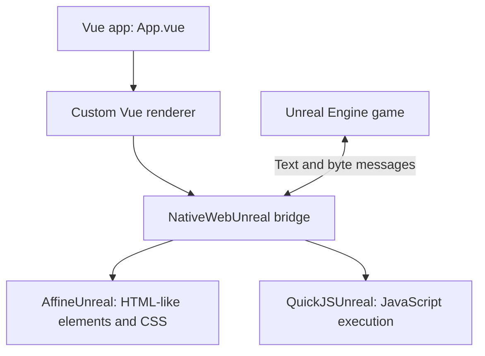

<div align="center">


<h1>Vue NativeWeb Example</h1>

<p><strong>A Vue 3 app rendered inside Unreal Engine through a custom Vue renderer — without embedding a browser.</strong></p>

<p align="center"><strong>HTML-like UI · CSS · JavaScript · Unreal text and byte communication</strong></p>

<p align="center">
  <a href="https://vuejs.org/"></a>
  <a href="https://www.typescriptlang.org/"></a>
  <a href="https://vite.dev/"></a>
  <a href="https://www.unrealengine.com/"></a>
  <a href="https://vuejs.org/"></a>
  <a href="https://github.com/ArtemIyX/AffineUnreal"></a>
  <a href="https://github.com/ArtemIyX/QuickJSUnreal"></a>
  <a href="https://github.com/ArtemIyX/NativeWebUnreal"></a>
  <a href="https://github.com/ArtemIyX/NativeWebUnreal"></a>
  <a href="LICENSE"></a>
</p>

</div>

This repository is a small example app for [NativeWebUnreal](https://github.com/ArtemIyX/NativeWebUnreal). It is a clicker app with custom CSS and bundled fonts, intended as a starting point for building Vue-powered game UI in Unreal Engine.

## How it works

The Unreal version runs Vue's reactivity and component logic in JavaScript, but it does not use Vue's browser DOM renderer. A custom renderer translates Vue's virtual nodes and updates into operations that NativeWebUnreal can send to its UI renderer.



- [NativeWebUnreal](https://github.com/ArtemIyX/NativeWebUnreal) connects the app, renderer, and Unreal Engine.
- [AffineUnreal](https://github.com/ArtemIyX/AffineUnreal) draws the supported HTML-like UI and CSS.
- [QuickJSUnreal](https://github.com/ArtemIyX/QuickJSUnreal) executes the JavaScript bundle.

The regular browser preview and Unreal build share `src/App.vue`. The browser preview uses Vue's standard DOM renderer; the Unreal build uses the custom renderer in `src/unreal`.

## HTML, CSS, and UI support

The example uses familiar web UI concepts: nested elements, text, attributes, click handlers, CSS layout and colors, media queries, and bundled fonts. Its markup includes `main`, `section`, `div`, `p`, `span`, `h1`, `output`, `button`, and inline SVG elements. The custom renderer forwards node creation, insertion, text, attribute, and removal operations to NativeWebUnreal. AffineUnreal determines which elements, CSS properties, and visual effects are supported and how they are drawn.

This is HTML-like UI rendering, not a complete HTML5 browser implementation. Check [AffineUnreal](https://github.com/ArtemIyX/AffineUnreal) for the renderer's current capabilities before relying on a specific tag, CSS property, or effect. A style that works in the browser preview may render differently or be unsupported in Unreal.

## Unreal communication

NativeWebUnreal provides two-way communication between Unreal and the UI using text and byte payloads. This is sufficient for typical UI-to-game messages and data updates; a WebSocket is not required for that communication. A WebSocket can be added for a custom communication flow or when your application prefers it for larger payloads.

The UI does not connect to the internet directly. Unreal can retrieve data through its own systems and pass it to the UI as JSON, Protocol Buffers, or raw bytes.

## Limitations

| Capability | NativeWeb example |
| --- | --- |
| Render this bundled Vue interface | Yes, through the custom renderer |
| Run the app's JavaScript | Yes, through QuickJSUnreal |
| Draw HTML-like elements and CSS | Supported subset through AffineUnreal |
| Exchange text and byte messages with Unreal | Yes, through NativeWebUnreal |
| Fetch remote URLs from UI JavaScript | No browser network access |
| Navigate to arbitrary websites | No |
| Embed YouTube or other remote pages in an `<iframe>` | No |
| Assume every browser CSS feature or visual effect works | No; support depends on AffineUnreal |

If your UI needs a full browser engine, remote websites, or browser features such as iframes, use [WebUserInterfaceUnreal](https://github.com/ArtemIyX/WebUserInterfaceUnreal), the CEF-based alternative.

## Run the browser preview

Requires Node.js `22.18+` or `24.12+`.

```sh
npm install
npm run dev
```

The browser preview is useful for iterating on the Vue app, but it does not reproduce every NativeWeb rendering difference.

## Build for Unreal

```sh
npm run build:unreal
```

The build creates `ui.js`, `ui.css`, and a `fonts` directory in `dist/unreal`. Copy them into your Unreal project's `Content/NativeWeb/Vue` directory. The NativeWebUnreal demo setup provides the `nativeWeb` bridge and the `#app` mount root.

## Project layout

| Path | Purpose |
| --- | --- |
| `src/App.vue` | Shared clicker UI and application state |
| `src/main.ts` | Browser preview entry point |
| `src/unreal/main.ts` | Custom Vue renderer and NativeWeb bridge integration |
| `src/unreal/native-web.d.ts` | TypeScript declarations for the NativeWeb bridge |
| `src/unreal/style.css` | Styles and font declarations for the Unreal build |
| `vite.unreal.config.ts` | Unreal bundle configuration |

## Related projects

- [NativeWebUnreal](https://github.com/ArtemIyX/NativeWebUnreal) — Unreal integration and example setup.
- [AffineUnreal](https://github.com/ArtemIyX/AffineUnreal) — HTML-like and CSS renderer.
- [QuickJSUnreal](https://github.com/ArtemIyX/QuickJSUnreal) — JavaScript engine integration for Unreal.
- [WebUserInterfaceUnreal](https://github.com/ArtemIyX/WebUserInterfaceUnreal) — CEF-based browser UI alternative.

## About this example

This repository demonstrates how to start a Vue app for NativeWebUnreal. Extend the app and its bridge integration to build your own in-game UI. It is an example project, not a standalone browser or a complete web compatibility layer.
